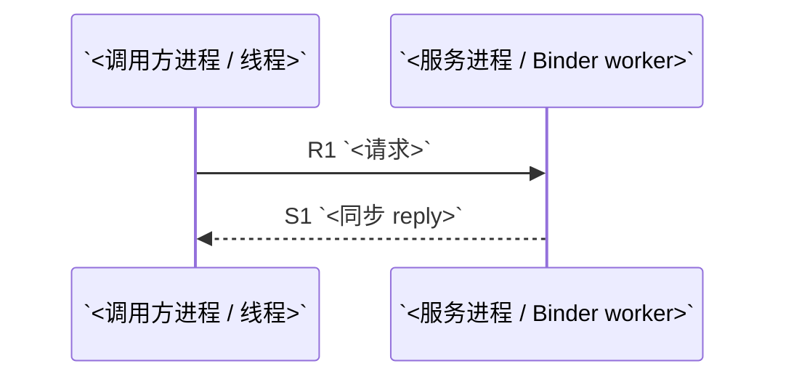
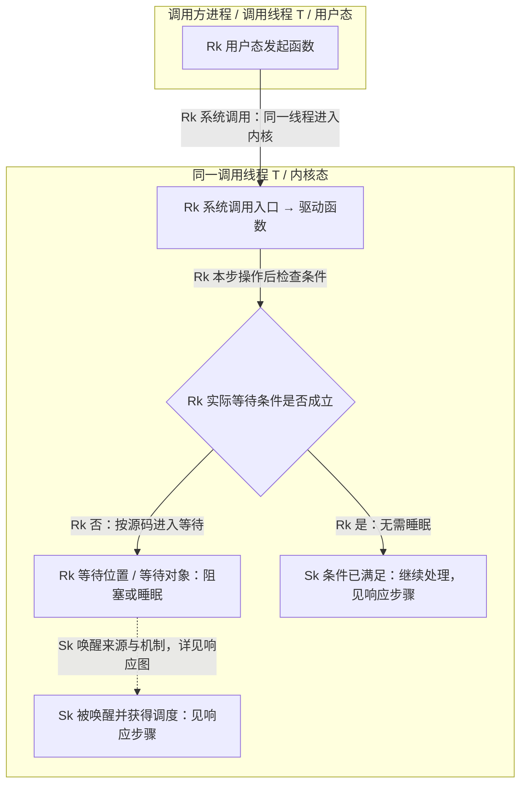
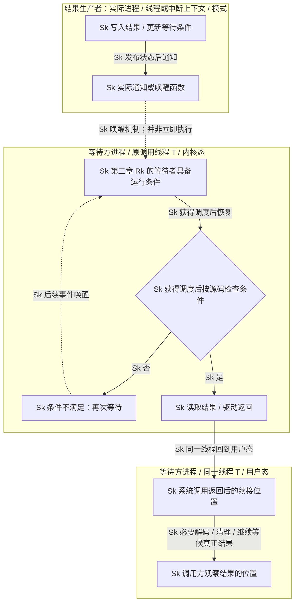

# `<API>` 调用链（`<baseline>`）

> 结论：`<SOURCE-CLOSED | CONTRACT-CLOSED | OPEN-GAP>`  
> 分析对象：`<准确类、方法签名或调用代码>`  
> 生成日期：`<YYYY-MM-DD>`
>
> 独立复核：`<已复核 | 部分复核 | 未复核；与闭环等级分开记录>`

## 1. 范围与源码基线

### 调用场景

`<调用位置、关键参数、用户/设备状态，以及不在范围内的初始化链或远端内部实现>`

### 基线清单

| 组件/仓库 | Tag / Build ID | Commit | 产品配置或来源 | 用途 |
|---|---|---|---|---|
| `<repo>` | `<tag>` | `<full commit>` | `<manifest/fingerprint/artifact>` | `<本链覆盖范围>` |

### 前置条件

- `<权限、feature flag、service/HAL 实例、初始化或缓存状态>`

### 完成与观察目标

- API 契约承诺：`<受理/投递确认、业务完成或状态事件；对应契约出处>`
- 本次观察目标与终点：`<结合用户范围确定；只证明受理时不声称业务完成>`
- 结果或通知形式：`<返回状态、reply、callback、Future、事件；没有业务完成通知时明确说明，用户仍要求业务完成时列出可确认范围及限制>`

### 需求澄清与任务分工

`<记录主 Agent 经对话明确的用户意图、观察目标和关键场景事实；已有信息充分时无需重复询问。各任务使用上方共同源码基线。>`

| 任务 / Agent | 负责范围与交付 | 前置依赖及衔接对象 |
|---|---|---|
| 主 Agent | 需求澄清、编排、汇总及最终报告 | 统一基线、编号并核对请求/响应接缝 |
| `<请求研究 Agent>` | `<入口到责任终点的范围与证据>` | `<与响应研究 Agent 交接的符号、数据和上下文>` |
| `<响应/回调研究 Agent>` | `<结果产生到可观察位置的范围与证据>` | `<回调注册、结果来源及与请求的关联>` |
| `<独立 Review Agent>` | `<固定源码复核范围；不兼任被审内容作者>` | `<已提交片段与主 Agent 整合稿>` |

`<按实际任务调整研究分工，说明并发任务与依赖顺序；若协作能力受限，记录实际未执行环节，不虚构 Agent 或复核结果。>`

## 2. 唯一主链

`<以下仅为同步跨进程调用的骨架；按实际链路重画。仅承诺投递的接口，展示调用方实际获得受理结果或提交确认的路径，不保留虚构的业务 reply；回调若在原线程重入，标明嵌套入口及外层尚未返回。>`



`<用一段话说明为何该基线与前置条件只选择这条实现；必要时简述其他分支的排除依据。>`

## 3. 请求链

`<说明源码摘录的省略标记、请求与响应的续接方式；链路较长时增加步骤导航，跨线程并行处说明编号只表示依赖关系。>`

<a id="r1"></a>

### R1. `<caller>` -> `<callee>`

**整体功能**：`<本步骤共同完成什么，入口与出口是什么，在请求主链中承担什么作用。>`

- 位置：`<repo@commit:path:line, symbol>`
- 执行：`<源进程/上下文>` -> `<切换机制>` -> `<目标进程/上下文>`；`<同步性>`
- 数据：`<参数及关键变化>`
- 说明：`<这一跳如何把请求推进到下一责任层>`

**内部调用链（包含多个调用时保留）**

`<在子步骤和源码之前，用调用树、箭头链或 Mermaid 图给出实际函数调用层级与顺序，标注 R1.1、R1.2 等子步骤及链接；说明各函数作用，标明同步调用、投递或 IPC 边界。若下方底层局部图已完整覆盖，可合并使用。>`

**底层局部调用图（本段涉及驱动/内核时保留）**

`<每段连续底层子链在首步源码前画图，注明覆盖的 R 步骤；其余步骤链接到该图。以下仅为阻塞调用的结构骨架，须依据目标源码重画，异步链改画投递、返回与消费入口，不适用节点删除。>`



`<图中 Rk/Sk 替换为实际步骤编号，节点与边替换为实际符号和机制。图例：实线表示同一上下文内的执行顺序，虚线表示通知或交接；简述请求如何推进。存在跨上下文投递时，补画实际队列、目标进程/线程或中断上下文及消费入口，不把队列当执行者。>`

| 执行者（进程 / 线程 / 模式） | 本段动作与交接对象 | 等待点、条件及机制 | 使条件成立并通知的一方 | 恢复入口与完成含义 |
|---|---|---|---|---|
| `<实际上下文>` | `<同步调用 / 异步投递到哪里>` | `<符号、等待对象及条件；或不等待>` | `<生产者及通知；或不适用>` | `<链接 S 步骤；受理/传输/业务结果>` |

`<图中节点/边对应的 R/S 步骤链接及源码出处见下文；无等待时用短文代替空表。>`

**源码调用（按调用下潜顺序）**

`<需要分解时，以下源码导读按 #### R1.1、#### R1.2 等子标题展开，分别添加 r1-1、r1-2 等显式锚点；各子步骤包含执行上下文、源码与出处、逐段讲解及后续入口。短小步骤可合并讲解，不保留空的子步骤。>`

① 调用点：`<caller symbol>`；源码：[文件与原始行段](<commit-pinned-caller-url>)。

```text
<摘录当前步骤的实际调用语句及必要上下文；替换代码块语言，并标出省略范围>
```

**源码讲解**：`<说明本次参数、调用作用和去向；简单转调用一两句带过，复杂逻辑按关键代码段解释。>`

② 被调用实现：`<callee symbol>`；源码：[文件与原始行段](<commit-pinned-callee-url>)。

```text
<摘录接收参数、选中分支及本步关键操作；需要多个实现时按调用顺序继续编号>
```

**源码讲解**：`<结合本次参数说明选中分支、数据或状态变化及后续执行；复杂的转换、锁、等待或交接需讲清机制，简单逻辑简述。每段源码就近讲解，紧密关联片段可合并覆盖。生成规则推导片段、既有绑定或源码缺口在相应片段旁明确标注。>`

**后续入口**：`<继续下潜/投递/等待/到达责任终点，以及对应步骤 ID 和锚点；共用实现已展示时，保留本次调用点并链接到该实现。>`

`<按 R2、R3... 继续，直至语义责任终点。>`

## 4. 响应链

`<按本次观察目标说明受理状态、业务结果或状态事件在哪里产生，沿哪个调用栈或通知入口被观察。有等待时关联请求暂停位置；仅承诺投递且没有业务完成通知时，展示受理返回或提交确认，不要求额外业务回复。>`

<a id="s1"></a>

### S1. `<result source>` -> `<observer>`

**整体功能**：`<本步骤如何使结果返回或被观察，结果入口与出口是什么，对应请求的哪个暂停位置或投递点。>`

- 位置：`<repo@commit:path:line, symbol>`
- 执行：`<源进程/上下文>` -> `<reply/callback/Handler/Executor/...>` -> `<目标进程/上下文>`
- 数据：`<返回值、错误或状态如何转换>`
- 说明：`<调用方在何处观察到完成>`

**内部调用链（包含多个调用时保留）**

`<在子步骤和源码之前，梳理结果产生、返回恢复或通知消费的实际函数链，标注 S1.1、S1.2 等子步骤及链接，并说明各函数作用。区分原栈返回、IPC reply、回调和异步投递；对应 R 步骤的暂停位置可定位。若下方底层局部图已完整覆盖，可合并使用。>`

**底层局部调用图（本段涉及驱动/内核时保留）**

`<注明覆盖的 S 步骤，有等待时链接第三章对应等待点；本段涉及底层时须有自己的响应图。以下仅是阻塞等待者恢复的骨架；无等待的受理返回、原栈直接返回、异步通知或同线程重入均按实际路径重画，不强加等待或业务通知。>`



`<图例同请求图。用白话解释谁产生结果、等待什么条件、谁通知谁，以及恢复后是否已完成业务；补全中间步骤，若仍需等待真正结果，画出后续等待与消费路径。不能将驱动返回或一次唤醒直接等同于业务完成。>`

| 执行者（进程 / 线程 / 模式） | 结果产生与通知机制 | 对应请求等待点 / 条件 | 恢复入口 | 调用方观察到的完成含义 |
|---|---|---|---|---|
| `<生产者与消费者分别说明>` | `<结果写入、reply / wake / callback>` | `<链接 R 步骤及等待对象；或不适用>` | `<实际恢复或回调消费符号、上下文>` | `<受理/传输/业务结果及后续步骤>` |

`<图中节点/边对应的 R/S 步骤链接及源码出处见下文；不存在等待时用短文解释实际返回路径。>`

**源码调用（按返回恢复或异步完成顺序）**

`<需要分解时，以下源码导读按 #### S1.1、#### S1.2 等子标题展开，分别添加 s1-1、s1-2 等显式锚点；各子步骤包含执行上下文、源码与出处、逐段讲解及后续入口。短小步骤可合并讲解，不保留空的子步骤。>`

① 结果或完成信号产生处：`<symbol>`；源码：[文件与原始行段](<commit-pinned-result-url>)。

```text
<摘录结果写入、return/reply/callback/Future completion 等当前步骤的实际语句>
```

**源码讲解**：`<说明结果如何产生、携带什么数据以及交给谁；简单返回简述，复杂的状态发布、通知或唤醒按关键代码段讲清。>`

② 返回续接或接收实现：`<symbol>`；源码：[文件与原始行段](<commit-pinned-resume-url>)。

```text
<摘录接收结果或从原调用点恢复的实现；保留关键条件、解码及影响完成时机的清理>
```

**源码讲解**：`<说明接收或恢复后执行哪些关键操作；复杂的解码、条件检查、线程交接或清理需讲清其对完成时机的影响，简单逻辑简述。每段源码就近讲解，紧密关联片段可合并覆盖。解释本步得到的是受理状态、传输状态还是业务结果，以及是否满足本次观察目标；若需要业务完成，继续追踪实际完成入口，无法证明时保留限制或 gap。>`

**后续入口**：`<下一个响应步骤或最终观察点的 ID 和锚点；同步返回注明对应请求步骤，异步返回注明消费上下文。>`

`<按 S2、S3... 继续，直至原调用方的可观察结果。>`

## 5. 失败、取消与清理

| 情形 | 触发点 | 传播/完成语义 | 清理或恢复 | 证据步骤 |
|---|---|---|---|---|
| `<权限拒绝/超时/取消/死亡/...>` | `<symbol>` | `<exception/error/callback/state>` | `<unlink/release/remove/...>` | `<E1>` |

## 6. 底层概念简释

- **`<概念>`**：`<只解释理解本链必需的 Binder/JNI/HAL/驱动等概念，并对应具体步骤。>`

## 7. 证据账本

`<子步骤使用完整 ID（如 R8.2、S8.1），与内部调用链、图和正文锚点对应；仅作总览的父步骤引用子步骤证据，不重复记账。>`

| ID | 方向 | Caller -> Callee | 源进程 | 源线程/上下文 | 切换机制 | 目标进程 | 目标线程/上下文 | 同步性 | 数据变化 | 源码 URL | Commit | 文件 | 符号 | 行号 | 证据类型 |
|---|---|---|---|---|---|---|---|---|---|---|---|---|---|---|---|
| `R1` | 请求 | `<caller -> callee>` | `<process>` | `<context>` | `<direct/Binder/Handler/JNI/...>` | `<process>` | `<context>` | `<sync/async/oneway>` | `<input -> output>` | `<commit-pinned URL>` | `<commit>` | `<path>` | `<symbol>` | `<line>` | `<SOURCE/CONTRACT/BINARY/RUNTIME/CORROBORATION>` |
| `S1` | 响应 | `<caller -> observer>` | `<process>` | `<context>` | `<reply/callback/...>` | `<process>` | `<context>` | `<sync/async>` | `<result transformation>` | `<commit-pinned URL>` | `<commit>` | `<path>` | `<symbol>` | `<line>` | `<type>` |

## 8. 旁证与限制

### 动态旁证

- `<设备 fingerprint、命令/trace、观察结果；没有匹配设备时写“未使用，不影响静态证据审计”。>`

### 已知缺口

- `<缺失实现/契约、未取得或无法访问源码的原因、受影响步骤和仍可确认的范围；相关正文或图中也须就近标注，不能只在此追加免责声明。无缺口时写“无”。>`

### 独立源码复核记录

- 受审正文版本 / 快照标识：`<实际经独立 Review Agent 核验的正文版本>`
- Review Agent 与源码基线：`<审查者标识；对应上方仓库 commit 清单>`
- 复核状态与覆盖范围：`<已复核 / 部分复核 / 未复核；实际核对的 R/S、图、讲解、异常清理和结论>`

| 范围 / 步骤 | 原结论或待核事实 | 固定源码 / 契约定位 | 核对结果 | 问题、修正与复核状态 |
|---|---|---|---|---|
| `<R/S、图或结论>` | `<待核关系或语义>` | `<repo@commit:path:line, symbol；或证据账本定位>` | `<已核实（SOURCE/CONTRACT） / 发现错误 / 无法核实>` | `<已修正并复核，或转为明确缺口；剩余未核实范围>` |

`<全部待审项已核对、错误已修正并复核、无法证实处已改为准确缺口后，才写“已复核”；抽查只能按实际覆盖记录。正文、图、步骤映射或结论修订后须复核变更及受影响上下游，旧稿记录不能代替最终稿复核。>`

## 9. 闭环结论

**等级：`<SOURCE-CLOSED | CONTRACT-CLOSED | OPEN-GAP>`**

`<说明本次观察目标、请求如何到达相应责任终点、约定的结果如何被调用方观察，以及决定该等级的最弱关键证据；受理成功与业务完成分别表述。>`
