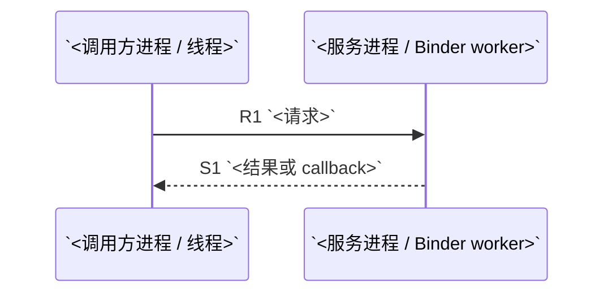

# `<API>` 调用链（`<baseline>`）

> 结论：`<SOURCE-CLOSED | CONTRACT-CLOSED | OPEN-GAP>`  
> 分析对象：`<准确类、方法签名或调用代码>`  
> 生成日期：`<YYYY-MM-DD>`

## 1. 范围与源码基线

### 调用场景

`<调用位置、关键参数、用户/设备状态，以及不在范围内的初始化链或远端内部实现>`

### 基线清单

| 组件/仓库 | Tag / Build ID | Commit | 产品配置或来源 | 用途 |
|---|---|---|---|---|
| `<repo>` | `<tag>` | `<full commit>` | `<manifest/fingerprint/artifact>` | `<本链覆盖范围>` |

### 前置条件

- `<权限、feature flag、service/HAL 实例、初始化或缓存状态>`

## 2. 唯一主链



`<用一段话说明为何该基线与前置条件只选择这条实现；必要时简述其他分支的排除依据。>`

## 3. 请求链

`<说明源码摘录的省略标记、请求与响应的续接方式；链路较长时增加步骤导航，跨线程并行处说明编号只表示依赖关系。>`

<a id="r1"></a>

### R1. `<caller>` -> `<callee>`

- 位置：`<repo@commit:path:line, symbol>`
- 执行：`<源进程/上下文>` -> `<切换机制>` -> `<目标进程/上下文>`；`<同步性>`
- 数据：`<参数及关键变化>`
- 说明：`<这一跳如何把请求推进到下一责任层>`

**源码调用（按调用下潜顺序）**

① 调用点：`<caller symbol>`；源码：[文件与原始行段](<commit-pinned-caller-url>)。

```text
<摘录当前步骤的实际调用语句及必要上下文；替换代码块语言，并标出省略范围>
```

② 被调用实现：`<callee symbol>`；源码：[文件与原始行段](<commit-pinned-callee-url>)。

```text
<摘录接收参数、选中分支及本步关键操作；需要多个实现时按调用顺序继续编号>
```

`<结合本次参数解释关键语句；生成规则推导片段、既有绑定或源码缺口在相应片段旁明确标注。>`

**后续入口**：`<继续下潜/投递/等待/到达责任终点，以及对应步骤 ID 和锚点；共用实现已展示时，保留本次调用点并链接到该实现。>`

`<按 R2、R3... 继续，直至语义责任终点。>`

## 4. 响应链

`<说明结果在哪里产生，沿哪个调用栈或异步完成入口返回；对应请求步骤的暂停位置在哪里。>`

<a id="s1"></a>

### S1. `<result source>` -> `<observer>`

- 位置：`<repo@commit:path:line, symbol>`
- 执行：`<源进程/上下文>` -> `<reply/callback/Handler/Executor/...>` -> `<目标进程/上下文>`
- 数据：`<返回值、错误或状态如何转换>`
- 说明：`<调用方在何处观察到完成>`

**源码调用（按返回恢复或异步完成顺序）**

① 结果或完成信号产生处：`<symbol>`；源码：[文件与原始行段](<commit-pinned-result-url>)。

```text
<摘录结果写入、return/reply/callback/Future completion 等当前步骤的实际语句>
```

② 返回续接或接收实现：`<symbol>`；源码：[文件与原始行段](<commit-pinned-resume-url>)。

```text
<摘录接收结果或从原调用点恢复的实现；保留关键条件、解码及影响完成时机的清理>
```

`<解释本步得到的是受理状态、传输状态还是业务结果；只有入队成功时，说明实际完成还需追踪的入口。>`

**后续入口**：`<下一个响应步骤或最终观察点的 ID 和锚点；同步返回注明对应请求步骤，异步返回注明消费上下文。>`

`<按 S2、S3... 继续，直至原调用方的可观察结果。>`

## 5. 失败、取消与清理

| 情形 | 触发点 | 传播/完成语义 | 清理或恢复 | 证据步骤 |
|---|---|---|---|---|
| `<权限拒绝/超时/取消/死亡/...>` | `<symbol>` | `<exception/error/callback/state>` | `<unlink/release/remove/...>` | `<E1>` |

## 6. 底层概念简释

- **`<概念>`**：`<只解释理解本链必需的 Binder/JNI/HAL/驱动等概念，并对应具体步骤。>`

## 7. 证据账本

| ID | 方向 | Caller -> Callee | 源进程 | 源线程/上下文 | 切换机制 | 目标进程 | 目标线程/上下文 | 同步性 | 数据变化 | 源码 URL | Commit | 文件 | 符号 | 行号 | 证据类型 |
|---|---|---|---|---|---|---|---|---|---|---|---|---|---|---|---|
| `R1` | 请求 | `<caller -> callee>` | `<process>` | `<context>` | `<direct/Binder/Handler/JNI/...>` | `<process>` | `<context>` | `<sync/async/oneway>` | `<input -> output>` | `<commit-pinned URL>` | `<commit>` | `<path>` | `<symbol>` | `<line>` | `<SOURCE/CONTRACT/BINARY/RUNTIME/CORROBORATION>` |
| `S1` | 响应 | `<caller -> observer>` | `<process>` | `<context>` | `<reply/callback/...>` | `<process>` | `<context>` | `<sync/async>` | `<result transformation>` | `<commit-pinned URL>` | `<commit>` | `<path>` | `<symbol>` | `<line>` | `<type>` |

## 8. 旁证与限制

### 动态旁证

- `<设备 fingerprint、命令/trace、观察结果；没有匹配设备时写“未使用，不影响静态证据审计”。>`

### 已知缺口

- `<缺失实现/契约、受影响步骤和仍可确认的范围；无缺口时写“无”。>`

## 9. 闭环结论

**等级：`<SOURCE-CLOSED | CONTRACT-CLOSED | OPEN-GAP>`**

`<说明请求如何到达责任终点、结果如何回到调用方，以及决定该等级的最弱关键证据。>`
